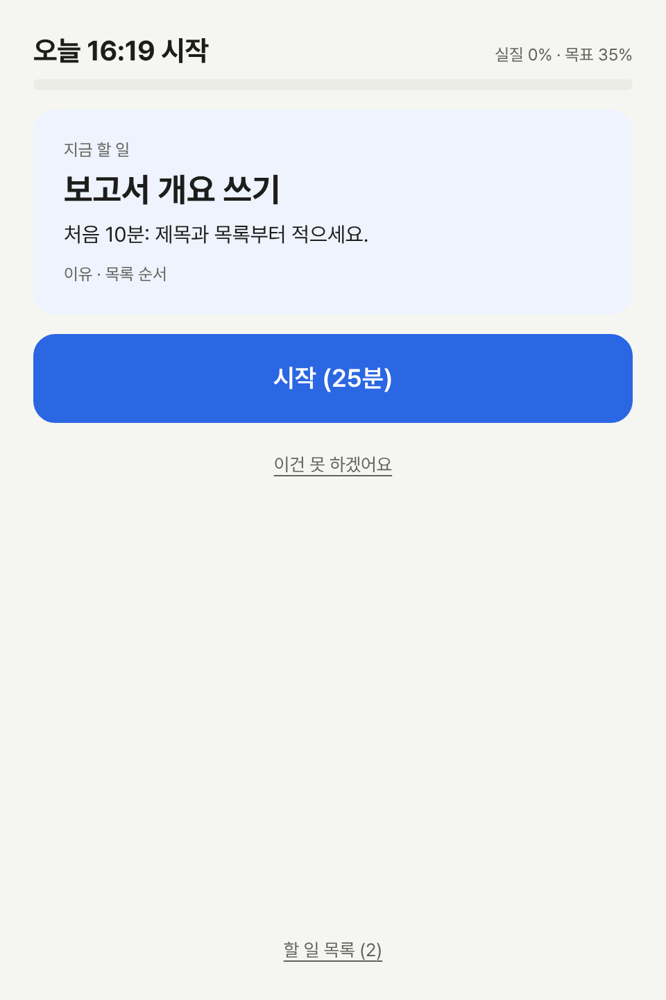
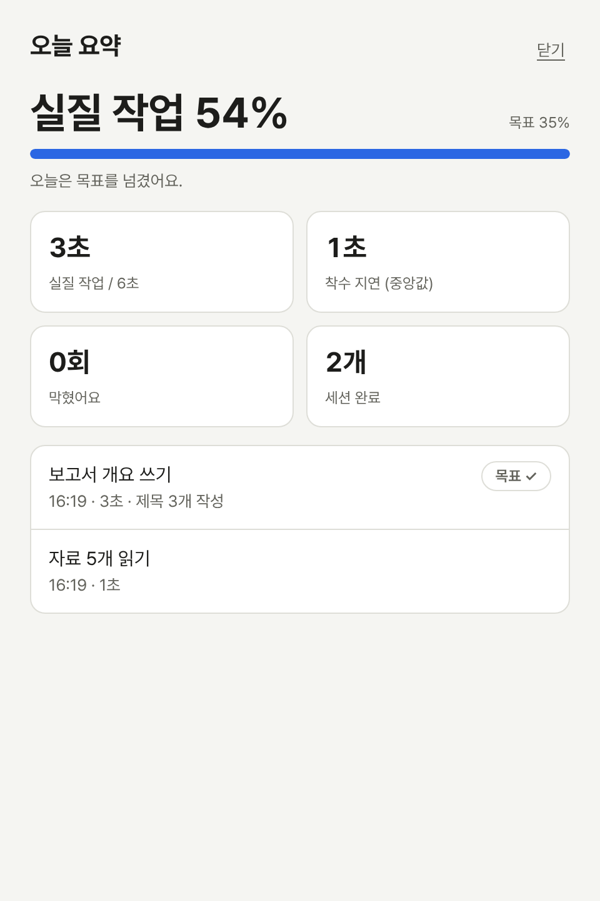

# JumpUp Now — 생각 과잉을 착수로 바꾸는 데스크톱 앱

[](https://github.com/sikomar00/tooMuchThinkerSolution/actions/workflows/ci.yml)

할 일 중 **지금 할 것 하나**를 골라 주고, 5~10분짜리 첫 행동으로 시작시킨 뒤, 하루의 **실질 작업비율**을 측정하는 Windows용 Electron 앱입니다(버전 0.1.3, 1단계 · AI 없음).

## 왜 만들었나

- **문제**: 생각이 많아 해야 할 일을 미룹니다. 체감상 하루의 약 20%만 실제로 일하고 있었습니다.
- **약점**: 그 "20%"와 원인은 추측이었습니다. 그래서 가설을 먼저 세웠습니다. *"적정한지 먼저 따지지 말고, 우선 해 보고 결과를 측정해 보완한다."*
- **접근**: 앱이 판단을 대신 내려 결정 비용을 없애고(추천은 항상 1개), 작게 시작시키고, 측정·회고합니다. 1~2주 동안 직접 써서 **기준선(baseline)** 을 만든 뒤, 그 숫자를 보고 2단계(AI 쪼개기·추천)를 할지 정합니다.

자세한 배경과 결정 과정은 [기획문서.md](기획문서.md)에 있습니다.

## 주요 기능

- **지금 할 일 하나 추천** — 마감·크기 점수로 할 일 1개와 첫 행동을 제시합니다. "이건 못 하겠어요"를 누르면 같은 일을 더 작은 첫 행동으로 다시 제안합니다.
- **상시 위젯** — 항상 위에 떠 있는 작은 창에 현재 할 일과 경과 시간을 보여 줍니다. 포커스를 빼앗지 않고, 위치를 기억합니다.
- **주기 체크인** — 25분 세션 중 10분마다 `진행 중 / 막혔어요` 2탭 토스트를 띄웁니다. 3번 연속 막히면 5분 휴식을 제안합니다.
- **앱이 먼저 시작시키기** — 하루 시작 알림, 전역 단축키, 트레이 상주, 부팅 시 자동 실행(옵트인).
- **측정 보정** — 절전 시 세션을 자동으로 멈추고, 체크인에 2번 답하지 않으면 자리 비움으로 보고 첫 무응답 시각으로 되돌립니다. 비정상 종료는 30초 heartbeat로 복구합니다.
- **회고와 하루 요약** — 산출물 한 줄, 목표에 가까워졌는지 1탭, 실질 작업비율·착수 지연·막힘 횟수를 보여 줍니다.

## 화면

아래는 e2e 시험(`npm run e2e`)이 시험용 데이터로 앱을 실제로 띄워 찍은 화면입니다.

| 온보딩 | 지금 할 일 추천 | 세션 진행 | 하루 요약 |
|---|---|---|---|
|  |  |  |  |

상시 위젯:


## 실행 방법

Node.js 20 이상이 필요합니다.

```bash
cd app
npm install
npm run dev        # 개발 모드
npm run dist       # Windows 설치파일 → app/release/JumpUpNow-Setup-<버전>.exe (서명 없음)
```

데이터는 내 PC에만 저장됩니다(`%APPDATA%\JumpUp Now\`의 추가 전용 이벤트 로그 `events/YYYY-MM.jsonl`과 `settings.json`). 1단계에는 네트워크 호출이 없습니다. 기준선은 `npm run report`로 이벤트 로그에서 계산합니다.

## 테스트

```bash
cd app
npm test           # 단위·통합 시험 (Vitest)
npm run typecheck  # 타입 검사
npm run build
npm run e2e:all    # 빌드된 앱을 실제로 띄우는 e2e 4종 (npm run build 선행)
```

- 단위·통합 시험은 10개 파일 156개입니다. 추천, 세션 상태 머신, 통계, 복구, 하루 경계 등 Electron에 의존하지 않는 도메인 로직(`app/src/domain/`)을 다룹니다.
- e2e는 Playwright로 Electron 앱을 띄워 온보딩부터 하루 종료까지 돌립니다. 시간 배율(`JUMPUP_TIME_SCALE=60`)과 격리된 데이터 경로(`JUMPUP_DATA_DIR`)를 써서 실제 데이터와 로그인 항목을 건드리지 않습니다.
- GitHub Actions는 `npm test`, `typecheck`, `build`를 돌립니다. e2e는 Windows 데스크톱을 전제로 해서 CI에는 넣지 않았습니다.
- 자동 시험이 보지 못하는 실제 입력·절전·자동 실행은 [수동체크리스트.md](수동체크리스트.md)로 확인합니다.

## 기술 스택

Electron · TypeScript(strict) · React · electron-vite · Vitest · Playwright · electron-builder(NSIS)

구조는 main process가 상태의 단일 출처이고, 메인 창·위젯·토스트 세 렌더러가 같은 상태를 구독해 그립니다(`contextIsolation`, `sandbox`, 허용한 IPC 채널만 노출). 자세한 내용은 [기술설계.md](기술설계.md)와 [app/README.md](app/README.md)에 있습니다.

## 문서

| 문서 | 내용 |
|---|---|
| [기획문서.md](기획문서.md) | 문제 정의, 인터뷰로 정한 결정, 3단계 출시 범위, 측정 계획, 리스크 |
| [와이어프레임_1단계.html](와이어프레임_1단계.html) | 1단계 화면 와이어프레임 |
| [기술설계.md](기술설계.md) | 프로세스 구조, 이벤트 로그 스키마, 지표 계산, 복구 규칙, 추천 규칙 |
| [도그푸딩가이드.md](도그푸딩가이드.md) | 기준선 수집 방법과 측정이 거짓이 되지 않게 지킬 규칙 |
| [수동체크리스트.md](수동체크리스트.md) | 설치 빌드에서 사람이 확인할 항목 |

## 상태와 한계

- 1단계(F1·F2·F3·F4a·F6)까지 구현했고, 제작자 본인의 도그푸딩으로 기준선을 모으는 단계입니다. 2단계(AI 쪼개기·추천)와 3단계(회고·방향 점검 고도화)는 아직 없습니다.
- Windows 우선입니다. 설치파일은 코드 서명이 없어 SmartScreen 경고가 뜨고, 자동 업데이트는 넣지 않았습니다.
- 측정은 타이머와 자기 보고(체크인 응답)에 기대므로, 세션을 켜 두고 딴짓하면 잡아내지 못합니다. 자리 비움 감지로 일부만 보정합니다.
- 한국어 전용입니다.
